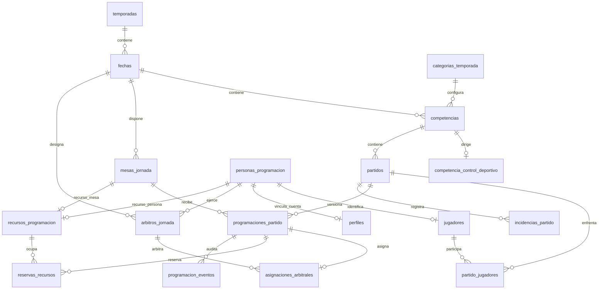

# Programación simultánea de jornadas — propuesta para revisión

Estado: programación en diseño, no implementada; futura migración 005. La migración 004 corresponde a inscripciones y está preparada para revisión, sin aplicar en Supabase.

## 1. Fuentes y límites

- Instrucción de la Liga en esta revisión: una fecha es un torneo de un solo día, con varias categorías y recursos compartidos. La simultaneidad está permitida si no hay conflictos de recursos.
- [Bases Oficiales 2026](./referencias/BASES%20LIGA%20REGIONAL%20TDM%20LOS%20RIOS.pdf), secciones 4–7: calendario documental, horarios específicos de la cuarta fecha, tarifas y plazos; sección 13: jugadores pueden ejercer arbitraje. El documento no define duraciones de partidos, descansos entre encuentros ni un algoritmo de programación. La sección 20 permite actualizaciones de la Liga.
- [Excel de cuarta fecha](./referencias/Grupos%204ra%20Fecha%20LR%202026.xlsx), única hoja `Grupos`: diez combinaciones individuales. No constituye una agenda de reservas con intervalos, mesas y árbitros. No deducir duración ni conflictos por el orden de las filas.
- Migraciones 001–003: `fechas`, `competencias`, `competencia_control_deportivo`, identidad deportiva y permisos existentes. No se sustituyen ni modifican sus archivos.
- Las jornadas actuales se consultan con el cliente SSR de Supabase y la sesión del Administrador. No hay semillas de fechas en el código. Registro, publicación administrativa y confirmación documental son conceptos diferentes; no se añade ahora una columna de confirmación inexistente.
- Solo individuales. No se modela ni se planifica Dobles.

## 2. Lo implementado ahora y lo pendiente

Administración dispone de resumen de jornada, contadores, cobertura de categorías, registro individual repetible en la misma fecha, estados independientes y consulta de inicios deportivos. Se conservan la unicidad `(fecha_id, categoria_temporada_id)` y las FK compuestas de temporada de 003.

Los inicios diferentes ya caben en `competencia_control_deportivo.inicio_programado`, una fila por competencia. Solo el Juez General puede escribir esa tabla. La vista administrativa no crea otro horario ni lo edita. Agrupar categorías por un mismo inicio es informativo: no demuestra ni impide solapamientos de partidos.

La futura agenda de mesas, encuentros y árbitros NO existe todavía. La vista actual no afirma que haya recursos disponibles ni que los conflictos estén resueltos.

## 3. Validación temporal actual

- Convertir formularios de America/Santiago a instantes UTC, usando reglas IANA, no un offset fijo. Rechazar horas inexistentes y pedir elección explícita en horas repetidas.
- Apertura anterior al cierre cuando ambos están informados. Cada plazo debe pertenecer al día de la jornada o a uno anterior en America/Santiago. Ambos deben ser anteriores o iguales al inicio deportivo si está registrado; esto es coherencia temporal técnica, no una nueva regla de admisión.
- El inicio deportivo debe caer en el día local de la jornada. Si no coincide, mostrar revisión del Juez General y bloquear publicación/habilitación; no cambiar su valor desde Administración.
- Ausencia de tarifa, cupo, plazos o inicio no se reemplaza por valores supuestos. Un borrador puede estar incompleto.
- Mostrar advertencias sobre registros históricos incoherentes. No corregirlos al consultar. Permitir retirar publicación/desactivar sin cambiar sus condiciones cuando lo permitan los triggers existentes; no usar esta vía para introducir plazos inválidos o volver a activar configuraciones incoherentes.
- Los triggers de 003 siguen siendo autoridad final. En particular, un cierre posterior a un inicio ya aprobado puede ser rechazado incluso al intentar retirar publicación. No se promete eludir esa restricción; requiere revisar la programación deportiva y el orden de corrección con el Juez General.
- La comprobación nueva del día local se realiza en la aplicación. **Todavía no es una restricción PostgreSQL sobre la configuración**: Table Editor o una escritura directa autorizada puede eludirla. 004 verifica el día local al solicitar y aceptar inscripciones. Para la futura 005 se proponen triggers aditivos en competencias, control deportivo y cambios del día de la fecha, bajo el mismo bloqueo transaccional existente. Auditar primero los datos actuales; no reinterpretarlos ni corregirlos en masa.
- No forzar automáticamente el jueves a las 20:00 del documento sobre todas las jornadas: confirmar vigencia y excepciones con la Liga. La aplicación no decide una excepción deportiva ni altera el dato existente.

## 4. Modelo propuesto para 005

Conservar la jerarquía: `temporadas → fechas → competencias → partidos`. Una categoría no genera otra fecha. Las tablas siguientes son propuestas, no tablas ya creadas.

| Entidad | Campos principales propuestos | Integridad y finalidad |
| --- | --- | --- |
| `personas_programacion` | `id uuid PK`, `nombre_referencia?`, auditoría | Identidad estable de una persona, independiente de sus funciones y de Auth. Nombre de referencia privado solo para externos sin ficha de jugador/perfil; no duplicar nacimiento, contactos o identificadores civiles. |
| `mesas_jornada` | `id PK`, `fecha_id FK`, `codigo`, `activo`, auditoría | `UNIQUE(fecha_id,codigo)`; mesas disponibles para todas las competencias de la jornada, no propiedad de una categoría. |
| `recursos_programacion` | `id uuid PK`, `persona_id FK? UNIQUE`, `mesa_jornada_id FK? UNIQUE` | CHECK exactamente uno de los dos vínculos. Una persona tiene el mismo recurso como jugador y como árbitro. |
| `partidos` | `id PK`, `competencia_id`, `fecha_id`, `temporada_id`, `numero`, `estado`, `inicio_real?`, `fin_real?`, auditoría | FK compuesta que asegura pertenencia a una competencia/fecha/temporada; `UNIQUE(competencia_id,numero)`. Flujo técnico pendiente/programado/en_juego/finalizado/cancelado, no reglas de clasificación. |
| `partido_jugadores` | `partido_id FK`, `puesto` 1/2, `jugador_id FK` | PK `(partido_id,puesto)` y UNIQUE `(partido_id,jugador_id)`; dos personas distintas. Pendiente puede tener plazas sin resolver; programar/abrir juego exige ambas identificadas y admitidas. |
| `arbitros_jornada` | `id PK`, `fecha_id FK`, `persona_id FK`, `activo`, referencia de designación, auditoría | `UNIQUE(fecha_id,persona_id)`; designación explícita del Juez. No exigir cuenta para que la persona exista. |
| `programaciones_partido` | `id PK`, `partido_id FK`, `fecha_id`, `mesa_jornada_id FK`, `revision`, `inicio`, `fin_estimado`, `vigente`, motivo/auditoría | UNIQUE partido/revisión y único vigente por partido; intervalo no vacío y fin posterior al inicio. Misma jornada para mesa y partido. |
| `asignaciones_arbitrales` | `id PK`, `programacion_id FK`, `arbitro_jornada_id FK`, auditoría | Un árbitro designado por programación en el alcance inicial; pertenencia a la misma jornada y persona distinta de ambos jugadores. No asignar por nombre. |
| `reservas_recursos` | `id PK`, `programacion_id FK`, `recurso_id FK`, `funcion`, `periodo_plan tstzrange`, `vigente`, `periodo_real tstzrange?` | UNIQUE programación/recurso. Reservas de mesa, dos jugadores y árbitro generadas solo por la operación transaccional; exclusiones por recurso e intervalo. |
| `programacion_eventos` | `id PK`, `programacion_id FK`, `tipo`, `motivo`, `antes/despues`, actor UUID snapshot, instante | Historial inmutable de programación, sustitución, cancelación y ejecución. Metadatos auditados, no reglas deportivas en JSON. |
| `incidencias_partido` | `id PK`, `partido_id FK`, `descripcion`, `estado`, autor snapshot, resolución/auditoría | Reportes privados del árbitro asignado o Juez; resolución del Juez. Sin catálogo de sanciones inventado. Implementar después de agenda básica. |

### Identidad de jugador/árbitro

Proponer columnas aditivas `jugadores.persona_programacion_id` y `perfiles.persona_programacion_id`, ambas FK y únicas. No se agregan ahora. El enlace real existente `jugadores.perfil_id` debe corresponder a la misma persona: validar mediante operaciones de identidad autorizadas por Administrador y triggers, también cuando cambie ese enlace.

La futura preparación de datos necesitará aprobación y auditoría: crear una identidad por jugador existente y asociar perfiles solo cuando exista un vínculo explícito verificable. Nunca fusionar por nombre. Jugadores sin cuenta siguen siendo válidos. Un árbitro externo puede tener persona/perfil sin registro de jugador; si tampoco tiene cuenta, exigir referencia nominal privada y verificación administrativa antes de designarlo. La RPC comprobará que toda persona designada dispone de fuente de identidad verificable. Proteger la identidad de las reservas históricas; no reasignarla silenciosamente al cambiar una cuenta.

Si hay duplicados reales desconocidos en el registro, ninguna restricción puede adivinar que dos IDs son la misma persona. Resolver identidad explícitamente antes de programar, conservando historial; no incorporar una fusión automática en 005.

### Relaciones e integridad

Las dos relaciones hacia recursos son alternativas, no dos vínculos simultáneos. `programaciones_partido` tiene muchas revisiones históricas, pero solo una vigente. La cardinalidad de participantes queda reforzada a exactamente dos antes de programar/iniciar, mediante validación diferida y RPC, no solo dos filas como máximo.

Añadir en la futura 005 las claves candidatas compuestas necesarias para las FK a fecha/temporada de competencias y partidos; no bastan FK independientes por ID para garantizar coherencia. Indexar todas las FK. Usar `ON DELETE RESTRICT`, bajas lógicas y auditoría, sin cascadas destructivas. No crear otro catálogo de categorías ni copiar tarifas en partidos.

`mesas_jornada` cubre los recursos compartidos dentro de una jornada. Si la Liga organiza jornadas coincidentes que comparten físicamente mesas, necesitará además un inventario físico común con disponibilidad por jornada; no se puede identificar una mesa física solo por el texto del recinto. Validar ese alcance antes de cerrar 005.

El modelo separa identidad, jornada, competencia, partido y revisión de agenda. Los intervalos copiados en reservas son una **desnormalización controlada** necesaria para la exclusión: triggers y RPC los derivan del plan y la ejecución; ningún cliente puede escribirlos libremente ni omitir jugadores de una reserva.

## 5. Conflictos por intervalos, incluida concurrencia

Propuesta: rangos `tstzrange` con límites `[inicio,fin)`; dos partidos adyacentes pueden compartir el límite sin solaparse. Las duraciones y eventuales márgenes son datos explícitos del Juez, sin una duración o descanso oficial supuesto. Los rangos PostgreSQL admiten comprobación de solapamiento y restricciones de exclusión GiST. [Documentación PostgreSQL: rangos y exclusión](https://www.postgresql.org/docs/current/rangetypes.html#RANGETYPES-CONSTRAINT).

En reservas, proponer exclusión por `recurso_id` con igualdad y `periodo_plan` con solapamiento, solo para reservas vigentes. Requerirá revisar disponibilidad de `btree_gist`. No incluir categoría en esa clave: dividir por categoría permitiría reservar dos veces a un jugador. El recurso de persona es global, por lo que tampoco se particiona la protección personal por fecha.

Una segunda exclusión por recurso y `periodo_real` protege la ejecución real. Al iniciar, ese rango tiene inicio real y extremo superior abierto; al finalizar se cierra con fin real. Una reserva futura tiene período real NULL: no se confunde la agenda estimada con una ocupación en curso. No liberar una mesa/persona porque venció su fin estimado. Un segundo partido no puede empezar mientras siga abierta una ocupación real del recurso.

Además: proponer un índice único parcial de ocupación real abierta por recurso, CHECK de límites/intervalos válidos y unicidad de recurso dentro de una programación. Para impedir arbitrar el propio encuentro, comparar `persona_programacion_id` con ambas personas participantes, no solo UUID de Auth. La exclusión también impide que una persona juegue y arbitre otros partidos simultáneamente.

Las exclusiones se comprueban en PostgreSQL y no se sustituyen por un `SELECT` seguido de varios INSERT desde Next.js. Las restricciones diferibles pueden facilitar cambios coordinados dentro de una transacción, pero deben cumplirse al confirmar. [PostgreSQL: restricciones y diferibilidad](https://www.postgresql.org/docs/current/sql-createtable.html).

### Operación atómica propuesta

1. Next.js comprueba Juez General y llama a una RPC con su sesión; la RPC vuelve a comprobar actor/rol, pertenencias, estado, versión esperada e identificador idempotente de solicitud.
2. Bloquear el partido y los recursos/personas afectados en un orden estable. Resolver identidades desde tablas confiables, nunca desde IDs de reservas enviados por el cliente.
3. Validar dos jugadores distintos y admitidos, árbitro designado no participante, mesa activa, jornada común y rango del mismo día local. La admisión no se deduce de estar en jugadores: coordinar con futuras inscripciones y habilitaciones; no confundir habilitación deportiva con inscripción.
4. Crear la revisión, asignación y cuatro reservas completas (mesa, dos personas jugadoras, persona árbitro); mantener invariantes de cantidad/identidad mediante triggers diferidos. Retirar revisión previa y sus reservas planificadas solo dentro de la misma transacción.
5. Exigir las exclusiones al confirmar. Un fallo revierte todo; devolver conflicto legible sin revelar datos personales no autorizados. No dejar árbitro, mesa o participantes parcialmente asignados.
6. Registrar evento con actor real y motivo. Usar versión esperada para rechazar edición obsoleta, y clave de solicitud única con huella del contenido para reintentos; una clave repetida con contenido distinto se rechaza.

RLS continúa en tablas y las escrituras directas a las tablas internas se revocan. Una RPC `SECURITY DEFINER`, si es necesaria, tendrá `search_path` fijo, nombres cualificados, privilegios mínimos, EXECUTE restringido y validación explícita de `auth.uid()`/rol; no confiar solo en RLS porque el propietario puede eludirla. [Supabase: RLS y funciones con privilegios](https://supabase.com/docs/guides/database/postgres/row-level-security).

### Retrasos y reprogramación

- No prolongar ni desplazar automáticamente una cadena de encuentros; informar al Juez de recursos en uso y partidos afectados.
- Reprogramar explícitamente los partidos aún no iniciados en una transacción; preservar revisiones y motivos. No modificar retroactivamente la programación de un encuentro en juego ni su período real para hacer espacio.
- Al iniciar con retraso, exigir revisión del intervalo planificado y sus conflictos. Si afecta planes futuros, el Juez debe resolverlos o dejarlos pendientes de reprogramación de manera explícita y atómica. No inventar una nueva duración ni anular resultados.
- Mientras un encuentro sigue en juego, sus reservas reales impiden iniciar otros con esos recursos, aunque haya transcurrido el horario previsto. Realtime puede refrescar la pantalla; no es la garantía de integridad.
- Mesa nueva con jugadores y árbitro distintos: simultaneidad permitida. Cambiar solo la mesa nunca resuelve el conflicto de una persona.

## 6. Pantalla futura del Juez General

Ruta prevista por jornada, no por categoría: selector temporada/fecha, tablero por mesas con intervalos y filtros de categoría/estado; cola de partidos sin programar; avisos de retraso/conflicto; vista de recursos ocupados; panel de avance por competencia; historial de reprogramaciones. En móvil, lista por mesa y cola con el mismo control transaccional.

Reutilizar autenticación SSR y componentes existentes. Acciones separadas de las administrativas: programar, reprogramar, iniciar, finalizar ejecución y reportar/resolver incidencias. La validación oficial de resultados será otra operación explícita del Juez: **finalizar ejecución no equivale a validar un resultado**. El módulo posterior de actas/resultados versionará la evidencia y su resolución; no se implementan aquí sets, llaves, clasificación ni ranking.

Para esa etapa posterior se propone `validaciones_resultado` con ID, FK al partido y a la futura versión del acta, estado de revisión, referencia/motivo de resolución y actor/instante estampados por servidor. No crearla en el alcance inicial de agenda ni inventar sus campos de puntuación: depende del diseño aprobado de actas. Las correcciones conservarán versiones previas y nunca convertirán automáticamente un partido finalizado en resultado validado.

### Permisos propuestos

| Rol | Lectura | Escritura |
| --- | --- | --- |
| Administrador | Resumen/agenda administrativa; identidad bajo acceso privado | Identidad y configuración administrativa actual. Sin asignar partidos, aprobar horarios deportivos o validar resultados. |
| Juez General | Agenda completa, disponibilidad, historial e incidencias de jornadas autorizadas | Mesas de jornada, designaciones, programación y reprogramación; inicio/cierre y resoluciones deportivas mediante RPC. |
| Árbitro | Solo encuentros asignados e información mínima necesaria | Reportes de sus encuentros y, en etapa posterior, actas; sin reasignar recursos ni validar resultados oficialmente. |
| Jugador | Sus encuentros y agenda publicada autorizada | Sin modificar agenda. Una designación explícita como árbitro podrá habilitar reportes de ese encuentro, sin otorgarle el rol global de Juez o Administrador. Validar este flujo con la Liga. |
| Público | Proyección publicada de agenda y resultados validados | Ninguna. Sin acceder a tablas privadas, nacimientos, cuentas, auditoría o incidencias. |

Hasta definir responsables por jornada, conservar el alcance actual de operadores; no inventar una asignación de Juez que la base aún no tiene. Si la Liga requiere varios jueces con ámbitos distintos, acordar una tabla de responsables y aplicar ese ámbito tanto en RLS como en RPC. Un árbitro sin cuenta se registra como persona designada, pero no obtiene acceso al sistema: el Juez registra la evidencia hasta disponer de acceso autenticado autorizado.

## 7. Implementación incremental para un desarrollador

1. Revisar con la Liga: identidad compartida jugador/árbitro; duración estimada y descansos si existen; alcances de jueces; tratamiento de cierres reglamentarios y excepciones; significado de confirmación de fecha; acceso de jugadores designados árbitros; cuándo puede iniciar una categoría respecto a su hora publicada.
2. Aprobar alcance de 005. Elaborar DDL y pruebas aisladas: identidad, mesas, partidos mínimos, participantes, designaciones, revisiones, reservas y auditoría. Incidencias puede incorporarse después de la agenda básica; actas/resultados necesitan otra revisión. Revisar primero dependencias de admisión/inscripciones: no habilitar encuentros reales con participantes aún no admitidos.
3. Auditar datos heredados y proponer correcciones manuales con autorización. Añadir protecciones temporales en BD sin cambiar los archivos 001–003. No crear partidos ni recursos ficticios en producción; probar con fixtures transaccionales solo en una base aislada.
4. Probar RPC y RLS antes de la UI deportiva. Implementar agenda manual mínima y después consulta de avance/reprogramación; no generar grupos automáticamente.
5. Incorporar actas, validación de resultados e incidencias cuando se apruebe su arquitectura. Llaves y ranking quedan fuera de esta etapa.

### Pruebas futuras obligatorias de 005 (no ejecutadas ahora)

- Misma mesa con intervalos parcialmente solapados e inicios diferentes: rechazar.
- Mismo jugador en categorías distintas, incluso en puestos distintos: rechazar solapamiento.
- Árbitro en dos partidos, persona jugando y arbitrando simultáneamente o arbitrando su propio partido: rechazar.
- Mismos horarios con cuatro recursos distintos por partido: permitir. Intervalos adyacentes: permitir sin descanso supuesto.
- Hora inexistente/repetida de Santiago, medianoche local, fecha/temporada cruzadas, mesa inactiva, rango vacío/infinito planificado, participantes incompletos: rechazar o dejar pendiente según estado, nunca publicar parcialmente.
- Dos conexiones intentan reservar simultáneamente un recurso: solo una confirma. Cambios coordinados al confirmar siguen cumpliendo todas las exclusiones.
- Fallo al reservar el último recurso: rollback completo; reintento idempotente no duplica revisiones. Edición obsoleta no pisa cambios ajenos.
- Retraso más allá del fin estimado: el recurso real sigue ocupado y otro partido no puede empezar. Reprogramar conserva historial y no libera una ocupación real activa.
- Negar escrituras deportivas de Administrador/Jugador/Árbitro y acceso anónimo a datos privados; probar también llamadas directas a RPC y DML directo, no solo los formularios.

Esta propuesta no afirma que tales conflictos estén impedidos actualmente: las tablas, restricciones y operaciones necesitan la revisión y autorización previas de 005.
